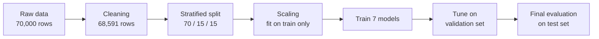

<div align="center">

# ❤️ Cardiovascular Disease Prediction Using Machine Learning

**Seven models. One fair split. 70,000 real patient records.**
A final year project that compares classical ML, gradient boosting and deep learning on a cardiovascular disease prediction task.

[](https://colab.research.google.com/github/abusaid17/Machine-Learning-Project/blob/main/Cardio_Disease_ML_Colab.ipynb)


[Highlights](#-highlights) · [Dataset](#-dataset) · [Pipeline](#-pipeline) · [Results](#-results) · [Quick start](#-quick-start) · [Author](#-author)

</div>

> ⚠️ **Disclaimer:** This is an educational project. It is not a medical device and must not be used for diagnosis or treatment decisions.

---

## ✨ Highlights

| 📦 Data | 🤖 Models | 🏆 Best ROC-AUC | 🎯 Test accuracy range |
|:---:|:---:|:---:|:---:|
| **70,000** patient records | **7** algorithms compared | **0.8033** (XGBoost) | **72% to 73%** |

- 🧹 **Real-world data cleaning:** impossible values (for example systolic blood pressure of 16,020 or -150) were found and removed.
- 🔒 **No data leakage:** the scaler is fitted on the training set only; the test set is used once at the end.
- 🧪 **Fair comparison:** every model uses the same stratified 70 / 15 / 15 train / validation / test split.
- 🧠 **Tuning on a validation set** (tree depth, K for KNN, early stopping for XGBoost and the CNN).
- 💬 **Honest conclusion:** very different algorithms land within about one percentage point of each other, because the data has only 11 features.

## 📚 Table of Contents

- [Overview](#-overview)
- [Dataset](#-dataset)
- [Pipeline](#-pipeline)
- [Models](#-models)
- [Results](#-results)
- [Key Findings](#-key-findings)
- [Limitations and Future Work](#-limitations-and-future-work)
- [Repository Structure](#-repository-structure)
- [Quick Start](#-quick-start)
- [Tech Stack](#-tech-stack)
- [Author](#-author)

## 🔍 Overview

| | |
|---|---|
| **Task** | Binary classification: does the patient have cardiovascular disease? |
| **Target** | `cardio` (1 = disease, 0 = no disease) |
| **Models** | Logistic Regression, Decision Tree, Linear Regression (baseline), SVM, XGBoost, K-Nearest Neighbors, 1D CNN |
| **Metrics** | Accuracy, Precision, Recall, F1, ROC-AUC |
| **Environment** | Python, Google Colab |

## 🗂 Dataset

The project uses the **Cardiovascular Disease dataset** published on Kaggle by Svetlana Ulianova.

🔗 https://www.kaggle.com/datasets/sulianova/cardiovascular-disease-dataset

- 70,000 patient records, 11 input features and 1 target (plus an `id` column)
- Classes are almost perfectly balanced (34,979 with disease, 35,021 without)
- No missing values, but the data contains entry errors that must be cleaned
- The CSV uses a **semicolon (`;`) separator**
- Please refer to the Kaggle page for the dataset's license and terms of use

| Feature | Description |
|---|---|
| `age` | Age in days (converted to years during cleaning) |
| `gender` | 1 = women, 2 = men |
| `height` | Height in cm |
| `weight` | Weight in kg |
| `ap_hi` | Systolic blood pressure |
| `ap_lo` | Diastolic blood pressure |
| `cholesterol` | 1 = normal, 2 = above normal, 3 = well above normal |
| `gluc` | 1 = normal, 2 = above normal, 3 = well above normal |
| `smoke` | Smoker (0/1) |
| `alco` | Alcohol intake (0/1) |
| `active` | Physical activity (0/1) |
| `cardio` | **Target:** cardiovascular disease (0/1) |

## ⚙️ Pipeline



**Cleaning rules**

- Drop `id`; convert `age` from days to years.
- Remove rows where `ap_hi` is outside 70 to 250, `ap_lo` is outside 40 to 200, or `ap_hi` is not greater than `ap_lo`.
- Remove rows where `height` is outside 120 to 220 cm or `weight` is outside 30 to 200 kg.
- Remove duplicate rows.
- Result: **70,000 rows reduced to 68,591** (1,409 removed).

**Split and scaling**

- Stratified split with `random_state=42`: **48,013 train / 10,289 validation / 10,289 test**.
- `StandardScaler` is fitted on the training set only. Scaled data is used by Logistic Regression, Linear Regression, SVM, KNN and the CNN; Decision Tree and XGBoost use unscaled data.

## 🤖 Models

| Model | Notes |
|---|---|
| Logistic Regression | `max_iter=1000` |
| Decision Tree | `max_depth` tuned from 1 to 20 on validation accuracy (best: 8) |
| Linear Regression | Baseline only: regression output thresholded at 0.5 |
| SVM | RBF kernel, `C=1.0`, `gamma='scale'` |
| XGBoost | Up to 500 estimators, learning rate 0.1, `max_depth=4`, early stopping (20 rounds) on validation log loss |
| KNN | K tuned over {3, 5, 9, 15, 21, 25, 31, 41, 51} on validation accuracy (best: 51) |
| 1D CNN | Keras model with early stopping on validation loss |

<details>
<summary><b>1D CNN architecture (click to expand)</b></summary>

```
Input (11 features, 1 channel)
  -> Conv1D(32, kernel 3, ReLU, same padding) -> MaxPooling1D(2)
  -> Conv1D(64, kernel 3, ReLU, same padding) -> MaxPooling1D(2)
  -> Flatten -> Dense(64, ReLU) -> Dropout(0.3)
  -> Dense(1, sigmoid)

Optimizer: Adam | Loss: binary cross-entropy
Batch size: 64 | Max epochs: 50 | EarlyStopping(patience=5, restore_best_weights=True)
```

</details>

## 📊 Results

Test-set results (10,289 patients), sorted by ROC-AUC. These are the values saved by the notebook in `model_comparison.csv`.

| Rank | Model | Accuracy | Precision | Recall | F1 | ROC-AUC |
|:---:|---|:---:|:---:|:---:|:---:|:---:|
| 🥇 | **XGBoost** | 0.7322 | 0.7557 | 0.6781 | 0.7148 | **0.8033** |
| 🥈 | **1D CNN** | 0.7315 | 0.7513 | 0.6836 | 0.7158 | 0.8006 |
| 3 | Logistic Regression | 0.7246 | 0.7524 | 0.6608 | 0.7036 | 0.7939 |
| 4 | Linear Regression (baseline) | 0.7215 | 0.7542 | 0.6486 | 0.6974 | 0.7934 |
| 5 | KNN (K = 51) | 0.7230 | 0.7463 | 0.6669 | 0.7044 | 0.7920 |
| 6 | SVM (RBF) | 0.7300 | 0.7598 | 0.6643 | 0.7089 | 0.7917 |
| 7 | Decision Tree (depth 8) | 0.7297 | 0.7536 | 0.6741 | 0.7117 | 0.7896 |

**ROC-AUC by model** (scale starts at 0.50, which is random guessing)

```
XGBoost              ████████████████████████████     0.8033
1D CNN               ███████████████████████████      0.8006
Logistic Regression  ███████████████████████████      0.7939
Linear Regression    ███████████████████████████      0.7934
KNN (K = 51)         ███████████████████████████      0.7920
SVM (RBF)            ███████████████████████████      0.7917
Decision Tree        ██████████████████████████       0.7896
```

Training accuracy is about 0.73 to 0.74 for every model, close to its test accuracy, so there is no sign of serious overfitting.

## 💡 Key Findings

1. **All seven models perform almost identically**: 72 to 73% accuracy and ROC-AUC between 0.79 and 0.80. XGBoost and the CNN are marginally ahead, but the gap is only about one percentage point, so the ranking should not be over-interpreted.
2. **The data sets the ceiling, not the algorithm.** With only 11 features, a simple Logistic Regression is almost as good as XGBoost or a deep network.
3. **Blood pressure and age matter most.** Systolic blood pressure has the strongest correlation with the target, followed by diastolic blood pressure, age, cholesterol and weight.
4. **Recall deserves attention.** Recall is about 65 to 68% across the models, so roughly one in three patients with the disease is missed. In a medical setting this false-negative rate matters as much as accuracy.

**Correlation of each feature with the target** (cleaned data; `░` marks a negative correlation)

```
Systolic BP (ap_hi)    +0.43  ██████████████████████████████
Diastolic BP (ap_lo)   +0.34  ████████████████████████
Age                    +0.24  █████████████████
Cholesterol            +0.22  ████████████████
Weight                 +0.18  █████████████
Glucose                +0.09  ██████
Gender                 +0.01  ▏
Alcohol                -0.01  ░
Height                 -0.01  ░
Smoking                -0.02  ░
Physical activity      -0.04  ░░░
```

## ⚠️ Limitations and Future Work

**Limitations**

- Only 11 measurements are available; richer clinical features would likely help.
- Results come from one dataset and one random split; they are not clinically validated.
- Data-entry errors were handled with simple range rules, not clinical review.
- KNN's best K was the largest value in the search grid, so a larger K might do slightly better.
- Linear Regression predicts numbers rather than classes and is included only as a baseline.

**Future work**

- [ ] Engineer new features such as BMI
- [ ] Use cross-validation and grid search
- [ ] Tune the decision threshold for higher recall
- [ ] Validate on an independent dataset
- [ ] Explain predictions with SHAP

## 📁 Repository Structure

```
.
├── Cardio_Disease_ML_Colab.ipynb   # Full pipeline: EDA, cleaning, 7 models, comparison
├── model_comparison.csv            # Test-set metrics for all models
├── cardio_train.csv                # Dataset file (source and terms: see Kaggle link above)
└── README.md
```

## 🚀 Quick Start

### Option 1: Google Colab (recommended)

1. Click the **Open in Colab** badge at the top of this page.
2. Make the dataset available to the notebook: upload `cardio_train.csv` to the Colab session, or place it in Google Drive and set `DATA_PATH` in the loading cell.
3. Choose **Runtime > Run all**. SVM, KNN and the CNN each take a few minutes.

### Option 2: Run locally

```bash
git clone https://github.com/abusaid17/Machine-Learning-Project.git
cd Machine-Learning-Project
pip install pandas numpy scikit-learn xgboost tensorflow matplotlib seaborn jupyter
jupyter notebook Cardio_Disease_ML_Colab.ipynb
```

The notebook was written for Colab. When running locally, skip the cells that use `google.colab` (`files.upload()` and `files.download()`) and set `DATA_PATH = 'cardio_train.csv'` with the CSV in the same folder.

## 🧰 Tech Stack

- **Language:** Python 3
- **Data:** pandas, NumPy
- **Classical ML:** scikit-learn (Logistic Regression, Decision Tree, Linear Regression, SVM, KNN)
- **Boosting:** XGBoost
- **Deep learning:** TensorFlow / Keras (1D CNN)
- **Visualization:** Matplotlib, Seaborn
- **Environment:** Google Colab / Jupyter

## 🙋 Author

**Md Abu Said**
Department of Computer Science and Engineering (CSE)
National Institute of Textile Engineering and Research (NITER)

Supervisor: Tanvir Ahmed

GitHub: [@abusaid17](https://github.com/abusaid17)

## 🙏 Acknowledgements

- Dataset: Svetlana Ulianova, *Cardiovascular Disease dataset*, Kaggle.
- Libraries: scikit-learn, XGBoost, TensorFlow, pandas and Matplotlib.

---

<div align="center">

If you found this project useful or interesting, please consider giving it a ⭐

</div>
